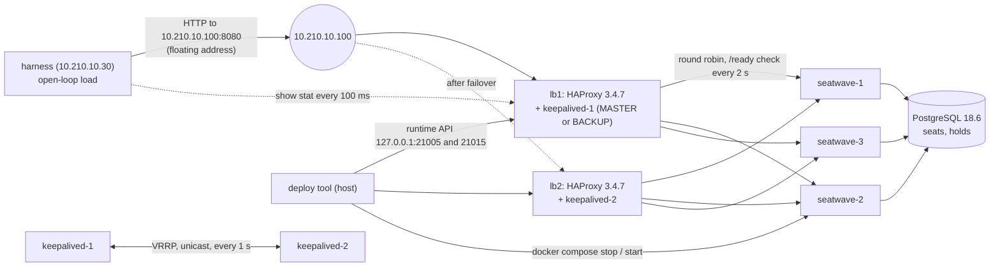

# Architecture

SeatWave on three stateless instances behind a redundant pair of HAProxy balancers, with the tools that kill, stop, drain and redeploy instances under load and count what fans would see. This is the project of Module 10, "Spreading the load", of the course System Design Fundamentals.

## Packages

All code is under `io.plainround.seatwave.balancer`.

| Package | What it holds | Runs where |
|---|---|---|
| `seatwave` | One SeatWave instance: the JDK HTTP server, the `Lifecycle` that enforces the drain rule, the routes `POST /v1/holds` and `GET /v1/holds/{holdId}`, the JDBC hold store, the settings, the metrics | In each instance container |
| `haproxy` | A client for HAProxy's runtime API (`show stat`, `set server ... state`), and the parsed stat table | Used by the harness and the deploy |
| `harness` | The open-loop load, one watch per balancer, and the report: the mix that ran, traffic share, failures, latency, removal analysis, longest gap, timeline | In the `harness` container on the lab network |
| `deploy` | The rolling deploy: drain, stop, wait until seen down, start, ready, wait until up, settle; one instance at a time, on every balancer | On the host, against the published runtime API ports |
| `config`, `json` | The settings reader with no defaults, and strict JSON binding (from the Module 9 project's review revision) | Everywhere |

## The dependency rule

`seatwave` depends on `config` and `json` only. `harness` and `deploy` depend on `haproxy`, `config` and `json`, never on `seatwave`: they talk to SeatWave over HTTP and to HAProxy over its runtime API, as an outside client would. `haproxy` depends on nothing but the JDK and result4j. Only the three `*Cli` classes print or exit.

## Data flow

## Walk-through: one hold

1. The harness sends `POST /v1/holds` with an `Idempotency-Key` to a balancer.
2. HAProxy picks an instance by the backend's algorithm, skipping instances that are down, in maintenance or drained.
3. The instance's only handler asks `Lifecycle.tryAdmit()`. Not ready: `503` with `Connection: close` and the body "nothing was done". Ready: the request counts as in flight until its response is written.
4. `JdbcHoldStore` looks the key up; a known key replays its hold, whichever instance made it. Otherwise one conditional `UPDATE` takes the seat, and an `INSERT` records the hold under the unique key, in one transaction.
5. The reply carries `X-Served-By`; HAProxy adds `X-Balancer`.

## Walk-through: a drain

1. The deploy sets `drain` on the instance in both balancers and backends that hold their own servers (`seatwave`, `seatwave_active_only`); the others track `seatwave` and follow it.
2. It waits until `scur`, the instance's current sessions, is 0 on every balancer.
3. `docker compose stop` sends SIGTERM. The shutdown hook calls `drainAndStop`: no new admission, wait for in-flight requests up to `drain.deadlineMillis` (20 s), then close the listeners, give the worker threads up to 5 s more (`SeatWaveServer.WORKER_STOP_WAIT`), and close the pool. The worst case, 25 s, is inside `stop_grace_period: 30s`.
4. The deploy waits until every balancer's checks show the instance `DOWN`, starts it, sets `ready`, waits until it is `UP`, and waits for slow start before the next instance.

## Walk-through: one lab run

1. `scripts/lab.sh` gives every held seat back, so the run starts with all 20,000 seats free.
2. The harness starts request `n` at `n / rate` seconds after the warm-up began, computed from the index, so the measured part starts at time zero exactly. Request `n` is a hold when `n mod 100` is below the hold share, so the mix is exact; the `k`-th hold asks for seat `(seed + k x 7,919) mod 20,000`, so 20,000 holds ask for 20,000 seats. A read asks for one of the last 1,024 holds the run made, or for a hold no run makes (404) while none is known yet.
3. Every planned request ends as exactly one outcome: an answer, a failure (with the exception or status), or not sent; a fault of the harness itself is a failure named `harness fault`, and `LoadRun.run` refuses to report if the count does not match.
4. The report prints the mix that ran, then everything else; the seats are given back again.

## Decisions and trade-offs

- **HAProxy, not NGINX, as the balancer.** Open-source NGINX has passive checks only (`max_fails`, `fail_timeout`); active health checks are in its commercial edition. HAProxy has active checks, slow start, a drain state and a runtime API in the open-source build, which is everything this module measures.
- **PostgreSQL in the stack, H2 in the tests.** PostgreSQL is the database later modules use. The tests run the same `db/schema.sql` on H2 in its PostgreSQL mode, so `./gradlew check` needs no Docker; the stack tests run the rules on PostgreSQL itself.
- **keepalived beside each HAProxy, in its network namespace.** The floating address lands on the balancer's own interface, and when a balancer's container dies its keepalived loses the network with it, as a dead machine would. Unicast VRRP needs no multicast on the Docker network. Both start as BACKUP with `nopreempt`; the priorities 101 and 100 change the wait before claiming the address by only 4 ms, so whichever keepalived starts first usually holds it, and the pair lab reads the holder instead of assuming it.
- **The labs give the seats back between runs.** A 30 s run asks for more holds than the arena has seats, and a hold lasts 300 s, so without the reset the next run would find every seat held and only `409`s; its reads would have nothing to read. One `UPDATE` of the lab's own database before and after each run keeps every run's mix the one its label says.
- **Two PRODUCTION mechanisms and one SIMPLE backend.** PRODUCTION (`seatwave`) adds a passive check and retries to the active check; `seatwave_active_only` has the active check alone, so the labs show what each mechanism buys.
- **The harness inside the lab network.** The floating address exists only there, and timings taken there do not cross Docker Desktop's port forwarder.
- **The deploy waits until the balancer has seen the instance down.** A restart faster than the detection time would otherwise go unnoticed: the balancer would send a full share to a cold instance at once, with no slow start.

## Invariants and where they are enforced

| Invariant | Enforced in | Tested by |
|---|---|---|
| No new request is admitted after draining starts | `Lifecycle.tryAdmit`, under the same lock as the state change; the server's one handler calls it before reading the request | `LifecycleTest.admitsNothingAfterDrainingStartsEvenUnderARace`, `SeatWaveServerTest.finishesTheRequestInFlightAndRefusesNewOnesWhileDraining` |
| An instance stops only when in-flight requests reach zero or the deadline passes | `Lifecycle.awaitDrained`, called by `SeatWaveServer.drainAndStop` before any listener closes | `LifecycleTest`, `SeatWaveServerTest.stopsAtTheDeadlineWhenARequestNeverFinishes` |
| One seat, one owner, across instances | The conditional `UPDATE` in `JdbcHoldStore` | `JdbcHoldStoreTest.letsExactlyOneOfManyRacersHoldOneSeat`, `StackTest.letsOneOfTwoInstancesWinOneSeat` (lb1 drained to `seatwave-1` and lb2 to `seatwave-2`, so the two racing holds land on two instances, which the test asserts) |
| A retried hold never holds twice | The unique `idempotency_key` in `holds`: read first, re-read after waiting on a racing request's row lock, and on a duplicate key (SQLState `23505`) rolled back and answered from the winner's row | `JdbcHoldStoreTest.answersRacingRetriesOfOneKeyWithOneHold` (row-lock path), `JdbcHoldStoreTest.answersTheLoserOfAKeyRaceWithTheWinnersHoldAndReleasesItsSeat` and `refusesTheLoserOfAKeyRaceWithAnotherBodyAndHoldsOneSeat` (the `23505` path, forced by a barrier at the INSERT), and on PostgreSQL `StackTest.answersTwoRacingCopiesOfOneRequestWithOneHoldOnPostgresql` and `refusesARacingKeyReusedForAnotherSeatAndKeepsThatSeatFreeOnPostgresql` |
| The balancer retries only what is safe to repeat | `retry-on conn-failure empty-response 503` in `haproxy.cfg`; `empty-response` may follow work, and is safe for a hold only through its `Idempotency-Key` | `InfrastructureRulesTest.retriesOnlyWhatIsSafeToRepeat`, mutation-checked |
| A load run reports one outcome per planned request, and the mix its label says | `LoadRun.run` (a harness fault is an outcome; a count mismatch refuses the report), the mix decided by the index, the seats given back by `scripts/lab.sh` | `LoadRunTest` |
| docker never kills a draining instance | `stop_grace_period: 30s` against `drain.deadlineMillis` plus `SeatWaveServer.WORKER_STOP_WAIT` | `ServiceSettingsTest.givesDockerStopMoreTimeThanTheWorstCaseShutdown` |
| No instance or database is reachable from outside the lab network | `compose.yaml` publishes only balancer ports, on 127.0.0.1 | `InfrastructureRulesTest.publishesOnlyBalancerPortsOnLoopbackInsideTheModulesRange` |
